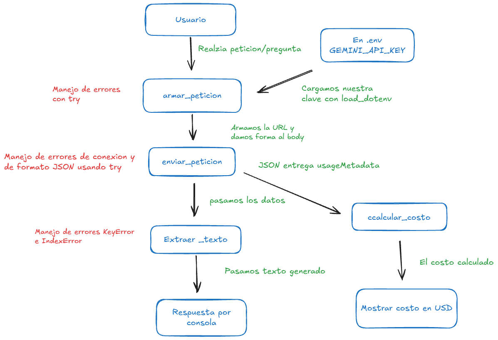

# Decisión de arquitectura: elección de modelo

Fecha de la comparación: martes 20 de octubre de 2026
Nombre de la miniaplicación: Planificador de astroturismo en Chile

## Modelo elegido

Elegí el modelo: **`gemini-3.5-flash-lite`** (Google Gemini, API de Google AI Studio)

Mi miniaplicación sirve para: responder a turistas, guías y operadores de astroturismo qué podrán ver en un lugar de Chile (Valle del Elqui, Atacama, etc.) en una fecha determinada, y cuál es el mejor momento para observar.

Los requisitos que necesito cumplir son:

* **Responder rápido:** el usuario espera la respuesta en el momento y la app se va a mostrar en una demo en vivo.
* **No inventar información:** reconocer lo que no sabe (por ejemplo, el clima de una noche futura) y no dar datos desactualizados que puedan hacer perder un viaje a un turista.
* **Costo bajo y disponibilidad:** funcionar en el nivel gratuito de Gemini, sin chocar con los límites de uso, y con un precio razonable si se pasa al nivel pagado.

## Diagrama de arquitectura

El diagrama (Bloque 8) muestra el flujo de la miniaplicación: el usuario hace una pregunta, `armar_peticion` arma la URL y el body con la clave cargada desde `.env`, `enviar_peticion` llama a la API, `extraer_texto` saca la respuesta y `calcular_costo` usa `usageMetadata` para mostrar el costo en USD. El modelo elegido en este documento es el que se usa en `armar_peticion` (la constante `MODELO` de `src/consumir_gemini.py`).

## Comparación de candidatos

- Estas son las preguntas y condiciones con las cuales se midieron los tres modelos (script: [`src/comparar_modelos.py`](../src/comparar_modelos.py)):

* Preguntas y/o condiciones:

1. **Latencia:** la misma pregunta ("Confirma la conexion") enviada 4 veces a cada modelo, con 3 segundos de pausa entre peticiones. Solo se mide el tiempo de `enviar_peticion` del intento exitoso; si Google responde 429 o 503, el script reintenta con backoff exponencial (1, 2, 4 y 8 segundos).
2. **Calidad:** tres preguntas reales de la miniaplicación: "Voy a Vicuña la noche del 13 al 14 de diciembre de 2026. ¿Qué puedo ver?", "¿Puedo ver las Perseidas desde el Valle del Elqui?" y "¿Puedo visitar ALMA este fin de semana?".
3. **Puntaje de calidad:** por pregunta, 2 = correcta y reconoce sus límites, 1 = parcialmente correcta, 0 = inventa o se equivoca (máximo 6).

| Criterio | `gemini-3.1-flash-lite` | `gemini-3.5-flash-lite` | `gemini-3.8-flash` |
|---|---|---|---|
| Tarifa de entrada en USD por millón de tokens | 0,25 | 0,30 | 0,75 (1,50 desde el 01-01-2027) |
| Tarifa de salida en USD por millón de tokens | 1,50 | 2,50 | 3,75 (7,50 desde el 01-01-2027) |
| Latencias observadas en segundos | 6,95 · 4,38 · 7,88 · 8,82 | 1,44 · 1,42 · 1,39 · 1,80 | 12,42 · 9,93 · 24,59 · (4.º intento: error 429) |
| Latencia promedio en segundos | 7,01 | 1,51 | 15,65 (promedio de 3 intentos) |
| Calidad para nuestra miniaplicación | 4/6 | 3/6 | No se pudo evaluar (error 429) |

Detalle de la calidad:

| Pregunta | `gemini-3.1-flash-lite` | `gemini-3.5-flash-lite` |
|---|---|---|
| 1. Vicuña, 13 al 14 de diciembre | **1**: identifica el máximo de las Gemínidas, pero es vago con la fase lunar y no dice que no puede saber el clima. | **0**: no menciona las Gemínidas, afirma "cielo despejado garantizado casi al 100 %" e inventa nombres de observatorios. |
| 2. Perseidas desde el Valle del Elqui | **2**: explica que el radiante queda muy bajo, que se ven muy pocas y recomienda las Gemínidas. | **1**: la conclusión es correcta ("no"), pero inventa una lluvia "Perseidas del Sur". |
| 3. Visitar ALMA este fin de semana | **1**: dice que no, pero da una razón equivocada (que nunca estuvo abierto al público) y no sabe que las visitas están suspendidas. | **2**: dice que no porque las visitas están suspendidas y recomienda revisar el sitio oficial. |

Fuente de las tarifas (nivel pagado, consultada el 20-10-2026):
- `gemini-3.1-flash-lite`: [Gemini Developer API pricing](https://ai.google.dev/gemini-api/docs/pricing)
- `gemini-3.5-flash-lite`: [Gemini Developer API pricing](https://ai.google.dev/gemini-api/docs/pricing)
- `gemini-3.8-flash`: [Gemini Developer API pricing](https://ai.google.dev/gemini-api/docs/pricing)

Observación sobre las pruebas:
- La app usa el nivel gratuito, así que hoy el costo real es 0. Las tarifas del nivel pagado sirven como referencia de cuánto costaría en producción.
- `gemini-3.1-flash-lite` tuvo tiempos muy variables (de 4,38 a 8,82 segundos) y en una corrida anterior respondió con error 503 (servicio saturado).
- `gemini-3.8-flash` respondió con error 429 (límite de uso del nivel gratuito) varias veces entre intentos y en el cuarto intento agotó los reintentos. Por eso su latencia es el promedio de 3 intentos y no se alcanzó a evaluar su calidad.
- Los tiempos varían en cada ejecución; estos números corresponden a la corrida del 20-10-2026.

## Justificación

Elegí el modelo **`gemini-3.5-flash-lite`** porque para mi aplicación **la velocidad de respuesta es clave**: un turista la consulta en el momento y se va a presentar en una demo en vivo.
Lo que observé en las pruebas fue que respondió en 1,51 segundos en promedio, casi 5 veces más rápido que `gemini-3.1-flash-lite` (7,01 s) y unas 10 veces más rápido que `gemini-3.8-flash` (15,65 s), con tiempos muy estables (entre 1,39 y 1,80 s). Además, fue el único que no tuvo errores de saturación ni de límite de uso, y acertó en la pregunta de información actualizada (las visitas a ALMA están suspendidas).
El criterio más relevante para mi decisión fue **la latencia**. El costo pesó poco: la diferencia con `gemini-3.1-flash-lite` es mínima (0,30 contra 0,25 USD por millón de tokens de entrada) y hoy uso el nivel gratuito. Además, `gemini-3.5-flash-lite` es estable y no tiene fecha de retiro.
Una limitación que encontré en mi elección fue **la calidad**: sacó 3/6, un punto menos que `gemini-3.1-flash-lite`, y en la pregunta de Vicuña no mencionó las Gemínidas e inventó datos. Lo voy a compensar en el Gate 2, donde la app obtendrá los datos astronómicos con herramientas (fase lunar, visibilidad, pronóstico) y RAG sobre documentos de astroturismo, en vez de depender de lo que el modelo sabe de memoria.

## Alternativa descartada y por qué

Descarté el/los modelos **`gemini-3.1-flash-lite`** y **`gemini-3.8-flash`** porque:

- **`gemini-3.1-flash-lite`:** tuvo la mejor calidad (4/6) y es el más barato, pero tardó en promedio 7,01 segundos y llegó a 8,82, lo que se siente lento para un usuario que espera la respuesta. Además, mostró errores 503 de saturación y Google lo retira el 07-05-2027, así que habría que reemplazarlo de todas formas.
- **`gemini-3.8-flash`:** es el más capaz, pero fue el más lento (15,65 segundos en promedio, con un intento de 24,59), el más caro (2,5 veces la tarifa de entrada de `gemini-3.5-flash-lite`, y el doble desde 2027) y el nivel gratuito lo bloqueó con error 429 casi en cada intento. Para una demo en vivo, ese límite es un riesgo real. Si más adelante la calidad de `gemini-3.5-flash-lite` no alcanza, este es el primer modelo que volvería a medir.
